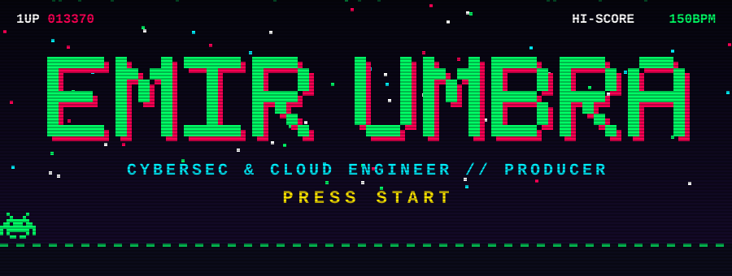
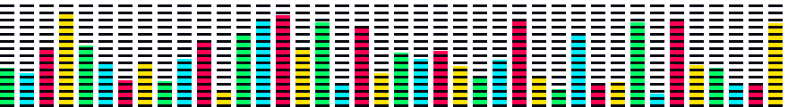

<div align="center">



<p align="center">
  
</p>

<p align="center">
  
  
  
  
</p>


</div>

---

### 🕹️ // PLAYER SELECT: WHOAMI

```bash
$ cat /etc/passwd | grep emirkefi
user@emirkefi:~$ whoami --verbose
> IDENTITY  : Emir Kefi // [Alias: UMBRA]
> ROLE      : 4th-Year Engineering Student (Cybersecurity & Cloud) @ ESPRIT
> FOCUS     : Cloud Architecture, Network Security, Backend Microservices & TUI Tooling
> AUDIO     : Hard Techno & Psytrance Producer (FL Studio / Serum 2 / Acid Sequences)
```

<div align="center"></div>

### ⚡ // POWER-UPS: SYSTEM INFRASTRUCTURE & TECH STACK

```bash
$ neofetch --config /etc/cybersec.conf
```

| Domain | Stack / Environment |
| :--- | :--- |
| **OS & Kernel** | `Arch Linux` • `Hyprland` • `rEFInd` • `Linux Kernel` • `UFW / Netplan` |
| **Backend & Cloud** | `PHP` • `Laravel` • `Filament` • `Docker` • `RabbitMQ` • `Microservices` |
| **Systems & Sec** | `Rust` • `Cisco OSPF / GNS3` • `Network Architecture` • `Bash` • `Git LFS` |
| **Audio Engine** | `FL Studio` • `Serum 2` • `Hard Techno (140-155 BPM)` • `Psytrance Design` |

<div align="center"></div>

### 🛠️ // LEVEL SELECT: DEPLOYED PAYLOADS & OPEN SOURCE

```bash
$ ls -la /opt/repositories/featured/
```

* 📦 [**`emirkefi/laravel-schema-drift`**](https://github.com/emirkefi/laravel-schema-drift) — Open-source Laravel package on Packagist for detecting and auditing database schema drift across environments.
* 🗺️ [**`emirkefi/laravel-topology-mapper`**](https://github.com/emirkefi/laravel-topology-mapper) — Automated architecture & topology mapping tool for complex Laravel applications.
* 🦀 [**`emirkefi/arch-disk-tui`**](https://github.com/emirkefi/arch-disk-tui) — High-performance terminal UI (TUI) built in Rust to inspect and analyze Linux filesystem storage.

<div align="center"></div>

### 🎛️ // BOSS STAGE: AUDIO SUBSYSTEM [ UMBRA ]

<div align="center">
  
</div>

```text
[ OSC 1: SAW/ACID ] ──► [ FILTER: 303 RESONANCE ] ──► [ DAW: FL STUDIO ] ──► [ OUTPUT: 150+ BPM ]
  ├── Genre     : Hard Techno / Industrial / Psytrance
  ├── Synthesis : Serum 2 Patch Design & Rolling Acid Basslines
  └── Status    : Sub-bass frequencies locked
```

<div align="center"></div>

### 📊 // HIGH SCORES: TELEMETRY & METRICS

<div align="center">
  
  
</div>

<div align="center">
  
</div>

<div align="center">
  
</div>

---

<div align="center">
  
</div>
